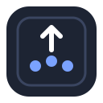

# swipekey

Turn Mac trackpad gestures into keystrokes and commands. Three fingers up, and it presses Return.

One small background app, one JSON file, no account, no subscription. The code is free software under the MIT license.

[](LICENSE)
[](#run-it)
[](https://github.com/Snouzy/swipekey/actions/workflows/ci.yml)

[Run it](#run-it) · [Configure](#configure) · [Extend it](#extend-it) · [License](LICENSE)

## See it in 20 seconds

https://github.com/user-attachments/assets/8ae8eca5-6d44-4450-a904-4cdcdbf22462

## Why

I wanted a three-finger swipe up to press Return. macOS can't map a gesture to a key, and the tool that can, BetterTouchTool, is paid and closed for what is one line of configuration. The open-source options I found were abandoned or did something else. So swipekey does that one thing, and is built so the next gesture or action is a small addition, not a rewrite.

## How it works

```
trackpad ─frames─▶ recognizers ─gesture─▶ engine ─▶ actions
           (MultitouchSupport)            (your config)
```

swipekey reads raw touches from Apple's `MultitouchSupport` framework, the same source the system gestures use. A recognizer turns them into gestures (for now, swipes with any number of fingers), and the engine runs the actions you bound to them: a keystroke with modifiers, or a shell command. It needs Accessibility permission to post keystrokes, and nothing else: no network, no telemetry.

## Run it

```sh
make install
```

Swift 5.9 or later (Xcode or the Command Line Tools) on macOS 13 or later. This builds `~/Applications/Swipekey.app`, writes a default config and registers a LaunchAgent, so swipekey **starts by itself every time you log in** and restarts if it crashes.

Then, once:

1. **Free the gesture.** System Settings → Trackpad → More Gestures: move *Mission Control* (or any gesture on the same fingers and direction) to four fingers, or turn it off.
2. **Allow it.** `make permissions` opens System Settings → Privacy & Security → Accessibility and shows the app in Finder: drag `Swipekey.app` into the list.
3. `make restart`, and swipe.

Swipekey puts a small trackpad icon in the menu bar. From it you can pause and resume the gestures, see the last gesture it recognized and your bindings, open the settings window (⌘,), edit and reload the config, open the log, and quit. In the settings window you add, change and delete bindings without touching the JSON: do the gesture on your trackpad (or pick it), press the shortcut you want, even a system one like ⌘Space, save, and it applies right away. The Sensitivity tab has a test area: your fingers show up live, a bar fills toward the threshold, and it tells you whether the swipe would fire, without running anything. The icon dims while paused and turns into a warning sign if swipekey can't send keystrokes. Quit stops it until your next login; after a crash it restarts by itself.

| Command | What it does |
|---|---|
| `make restart` | Reload after editing the config or granting permission |
| `make logs` | Follow the log (`~/Library/Logs/swipekey.log`) |
| `make test` | Unit tests, no trackpad needed |
| `make uninstall` | Remove the app and the LaunchAgent, keep the config |

`swipekey --debug` prints every gesture it recognizes.

## Configure

`~/.config/swipekey/config.json`, then *Reload config* in the menu (or `make restart`):

```json
{
  "swipeThreshold": 0.12,
  "bindings": [
    { "gesture": { "type": "swipe", "fingers": 3, "direction": "up" },
      "action":  { "type": "key", "key": "return" } },

    { "gesture": { "type": "swipe", "fingers": 3, "direction": "up" },
      "holding": ["cmd"],
      "action":  { "type": "key", "key": "return", "modifiers": ["shift"] } },

    { "gesture": { "type": "swipe", "fingers": 3, "direction": "down" },
      "action":  { "type": "shell", "command": "open -a Terminal" } }
  ]
}
```

| Field | Values |
|---|---|
| `gesture` | `swipe` with `fingers` (2 and up) and `direction` (`up`, `down`, `left`, `right`), or `pinch` with `fingers` (2 and up) and `direction` (`in` toward the centre, `out` apart) |
| `holding` | optional: modifier keys you hold on the keyboard during the gesture (`cmd`, `shift`, `option`, `control`). The binding fires only with exactly those held, so a plain swipe and a ⌘ + swipe can do different things |
| `action` | `key` with `key` and optional `modifiers` (`cmd`, `shift`, `option`, `control`, `fn`), or `shell` with `command` |
| `key` | `a`–`z`, `0`–`9`, punctuation, `return`, `enter`, `tab`, `space`, `delete`, `escape`, arrows, `home`, `end`, `pageup`, `pagedown`, `f1`–`f12`, or a numeric key code. Characters follow your keyboard layout: `z` is the key that types z, on QWERTY, AZERTY, QWERTZ or Dvorak |
| `swipeThreshold` | how far the fingers travel before it fires, as a fraction of the trackpad (default `0.12`) |
| `pinchThreshold` | how much the fingers close or spread before a pinch fires, as a fraction of the trackpad (default `0.05`) |
| `blockScrollWithFingers` | swallow scrolling while this many fingers (or more) touch the trackpad, so a swipe doesn't also scroll the window underneath (default `3`, `0` turns it off) |
| `menuBarIcon` | show the menu bar icon (default `true`, also in the settings window). Set it back to `true` and `make restart` if you hid it and want it back |
| `editor` | app that *Edit config…* opens the file with, e.g. `"Cursor"` or `"Visual Studio Code"` (default: your default app for JSON). Also set from the menu's *Open config with* |
| `remaps` | key events to rewrite: `from` (`key`, optional exact `modifiers`, optional `app` name or bundle id of the sender) → `to` (`key`, `modifiers`). Rewritten in place before any app sees them; no cost when empty. See the recipe below |

## Examples

Each recipe is one or two entries to paste into `bindings`. Some recipes use the same gesture: pick one per gesture, since a gesture bound twice runs both actions. Before using one, check that macOS doesn't already use that gesture (System Settings → Trackpad → More Gestures).

### Press Enter with a three-finger swipe on Mac

Send messages, confirm dialogs or run terminal commands without reaching for the keyboard.

```json
{ "gesture": { "type": "swipe", "fingers": 3, "direction": "up" },
  "action":  { "type": "key", "key": "return" } }
```

### Switch browser tabs with a trackpad swipe

Previous and next tab in Safari, Chrome, Arc, Firefox and most editors. `⌃⇧Tab` and `⌃Tab` work on every keyboard layout, unlike `⌘⇧[`, which has no single key on AZERTY.

```json
{ "gesture": { "type": "swipe", "fingers": 4, "direction": "left" },
  "action":  { "type": "key", "key": "tab", "modifiers": ["control", "shift"] } },
{ "gesture": { "type": "swipe", "fingers": 4, "direction": "right" },
  "action":  { "type": "key", "key": "tab", "modifiers": ["control"] } }
```

### Combine a trackpad gesture with a modifier key (Command, Option, Shift)

Hold a key on the keyboard while you swipe to get a second action on the same gesture. Here a plain swipe up sends Return, and ⌘ + swipe up sends ⇧Return (a new line in Slack, Messages or ChatGPT instead of sending).

```json
{ "gesture": { "type": "swipe", "fingers": 3, "direction": "up" },
  "action":  { "type": "key", "key": "return" } },
{ "gesture": { "type": "swipe", "fingers": 3, "direction": "up" },
  "holding": ["cmd"],
  "action":  { "type": "key", "key": "return", "modifiers": ["shift"] } }
```

### Trigger a shortcut with a two-finger pinch

Pinch two fingers toward the centre to press `⌘@`. `@` follows your layout, like any character key.

```json
{ "gesture": { "type": "pinch", "fingers": 2, "direction": "in" },
  "action":  { "type": "key", "key": "@", "modifiers": ["cmd"] } }
```

macOS still zooms on a two-finger pinch in apps that support it: turn off *Zoom in or out* in System Settings → Trackpad → Scroll & Zoom if that gets in the way.

### Close a tab or window with a gesture

```json
{ "gesture": { "type": "swipe", "fingers": 4, "direction": "down" },
  "action":  { "type": "key", "key": "w", "modifiers": ["cmd"] } }
```

### Undo and redo with a swipe

```json
{ "gesture": { "type": "swipe", "fingers": 3, "direction": "left" },
  "action":  { "type": "key", "key": "z", "modifiers": ["cmd"] } },
{ "gesture": { "type": "swipe", "fingers": 3, "direction": "right" },
  "action":  { "type": "key", "key": "z", "modifiers": ["cmd", "shift"] } }
```

### Press Escape with the trackpad (Vim, dialogs, full screen)

```json
{ "gesture": { "type": "swipe", "fingers": 3, "direction": "down" },
  "action":  { "type": "key", "key": "escape" } }
```

### Take a screenshot with a gesture

Opens the macOS selection screenshot (`⌘⇧4`).

```json
{ "gesture": { "type": "swipe", "fingers": 5, "direction": "up" },
  "action":  { "type": "key", "key": "4", "modifiers": ["cmd", "shift"] } }
```

### Play or pause music with a swipe

Apple Music; replace `Music` with `Spotify` for Spotify.

```json
{ "gesture": { "type": "swipe", "fingers": 5, "direction": "down" },
  "action":  { "type": "shell", "command": "osascript -e 'tell application \"Music\" to playpause'" } }
```

### Change the volume with a trackpad gesture

```json
{ "gesture": { "type": "swipe", "fingers": 5, "direction": "right" },
  "action":  { "type": "shell", "command": "osascript -e 'set volume output volume ((output volume of (get volume settings)) + 10)'" } },
{ "gesture": { "type": "swipe", "fingers": 5, "direction": "left" },
  "action":  { "type": "shell", "command": "osascript -e 'set volume output volume ((output volume of (get volume settings)) - 10)'" } }
```

### Open an app or a website with a swipe

```json
{ "gesture": { "type": "swipe", "fingers": 4, "direction": "up" },
  "action":  { "type": "shell", "command": "open -a Terminal" } }
```

`open https://github.com` works the same way for a URL.

### Run an Apple Shortcut from the trackpad

Anything you built in the Shortcuts app: toggle Focus, start a timer, post to a webhook.

```json
{ "gesture": { "type": "swipe", "fingers": 2, "direction": "up" },
  "action":  { "type": "shell", "command": "shortcuts run \"My Shortcut\"" } }
```

Two-finger swipes also scroll the page, so keep them for actions where that doesn't matter.

### Lock the screen with a gesture

Turns the display off; it locks if *Require password* is set to *Immediately* in Lock Screen settings.

```json
{ "gesture": { "type": "swipe", "fingers": 5, "direction": "down" },
  "action":  { "type": "shell", "command": "pmset displaysleepnow" } }
```

### Fix a mouse button shortcut that loses its modifiers (Logi Options+)

Some mouse utilities send a shortcut's key without its modifiers on non-US keyboards: Logi Options+ sends a plain Space for ⌃⌥Space on French AZERTY, so dictation apps like Wispr Flow never see the shortcut. Map that button to Space in the mouse app, then put the modifiers back, only for events that app sends (your real space bar is untouched):

```json
"remaps": [
  { "from": { "key": "space", "app": "Logi Options+" },
    "to":   { "key": "space", "modifiers": ["control", "option"] } }
]
```

`remaps` sits next to `bindings` at the top level of the config.

## Extend it

- **A new action** (open a URL, run a Shortcut): a case in `ActionSpec` and a type that conforms to `Action`, in [`Actions.swift`](Sources/SwipeKeyCore/Actions.swift).
- **A new gesture** (taps, pinches): a case in [`Gesture`](Sources/SwipeKeyCore/Gesture.swift), a `GestureRecognizer` in [`Recognizers.swift`](Sources/SwipeKeyCore/Recognizers.swift), and one line in `Engine.init`. Recognizers are plain classes fed with touch frames, so they are tested without a trackpad.

## Repository

- `Sources/CMultitouch/`: the C bridge that loads `MultitouchSupport` and forwards touch frames.
- `Sources/SwipeKeyCore/`: gestures, recognizers, actions, config and the engine.
- `Sources/swipekey/`: the command-line entry point.
- `support/`: the app's `Info.plist` and the LaunchAgent template.
- `Tests/`: unit tests for recognition and config.

## Caveats

- `MultitouchSupport` is private Apple API. It has been stable for over a decade and many tools rely on it, but a macOS update could break it.
- `make install` signs the app with your Apple Development or Developer ID certificate when your keychain has one, and macOS then keeps the Accessibility grant across updates. Without a certificate the app is signed ad hoc, and macOS ties the grant to that exact build: after each update, turn Swipekey off and on in the Accessibility list, then `make restart`. Either way, `make install` only replaces the app when the code changed.
- macOS still sees the gesture. If a system gesture uses the same fingers and direction, both fire. With those gestures off, macOS treats a three-finger swipe as plain scrolling: swipekey swallows that scrolling (see `blockScrollWithFingers`).

## License

Copyright (C) 2026 Snouzy and the swipekey contributors. [MIT](LICENSE).
